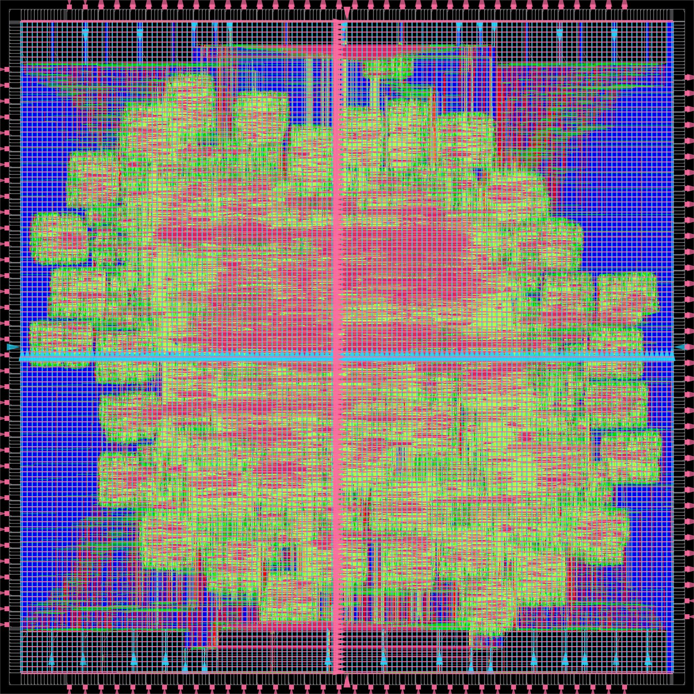
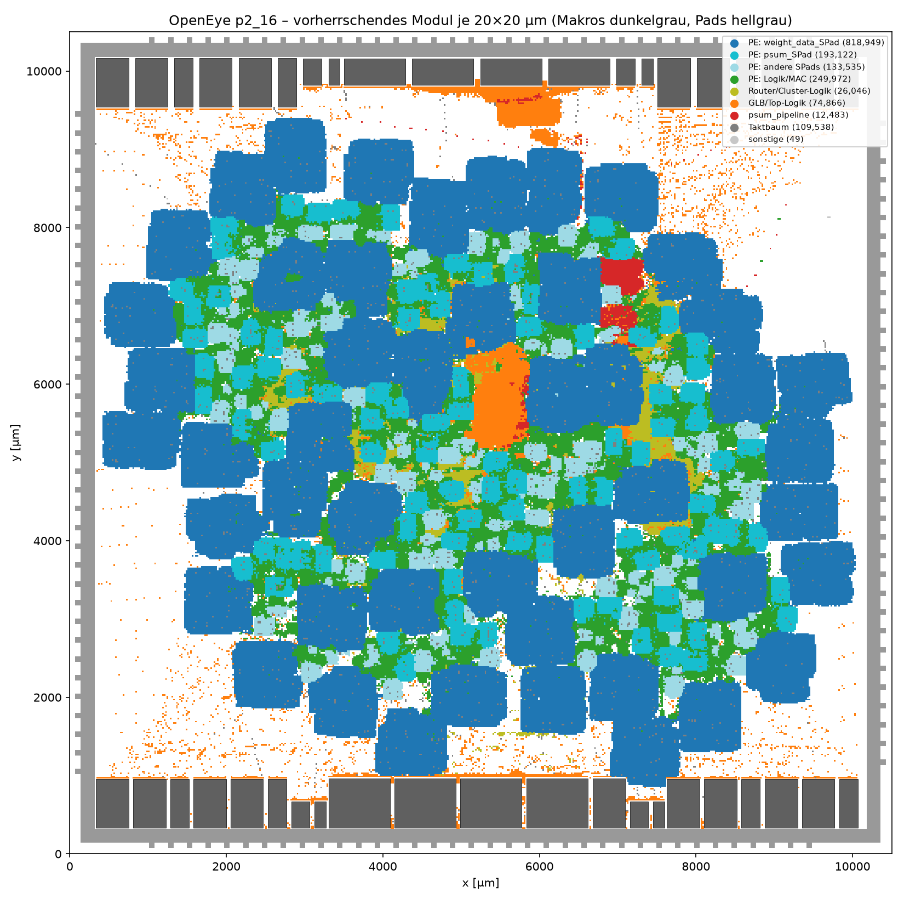
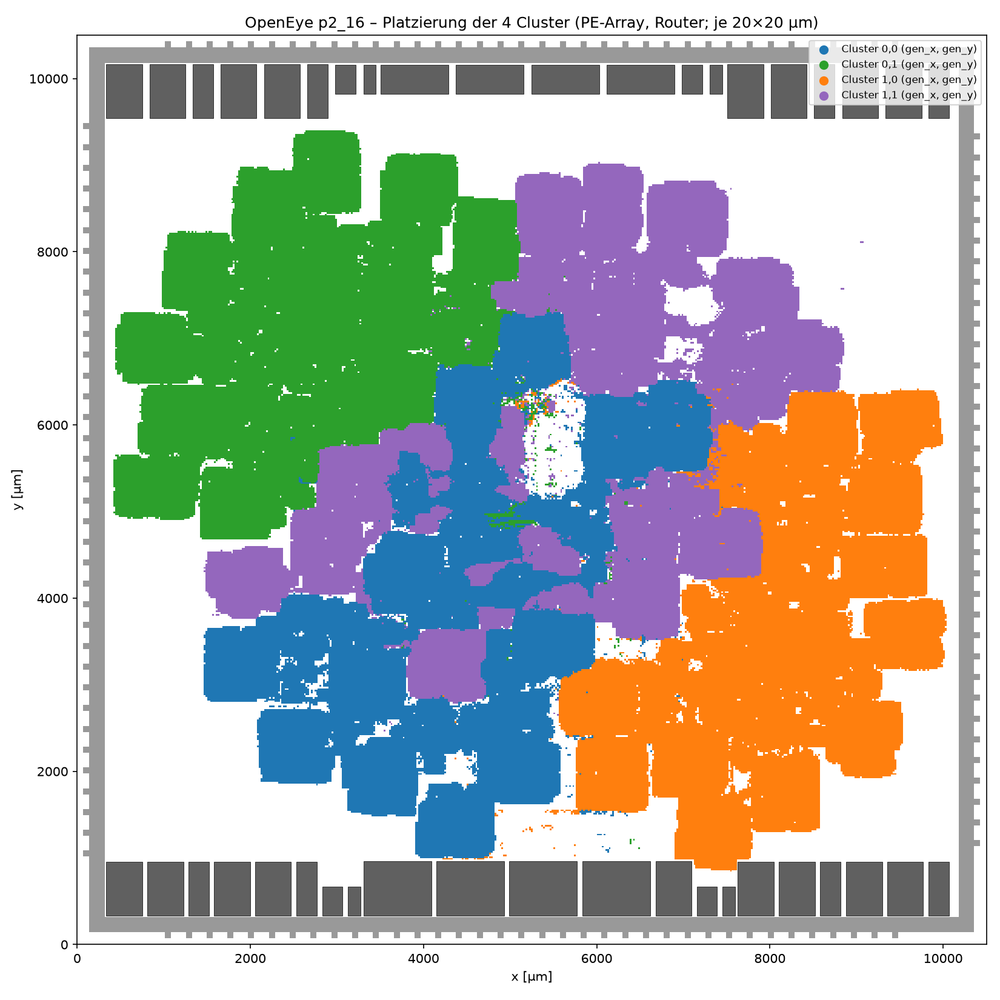
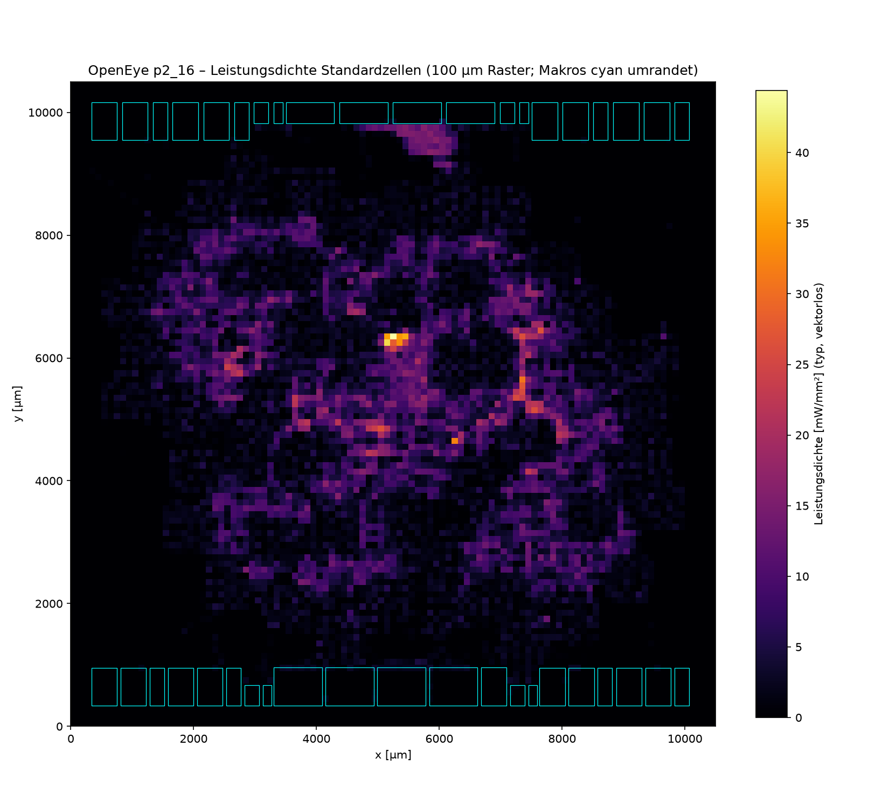
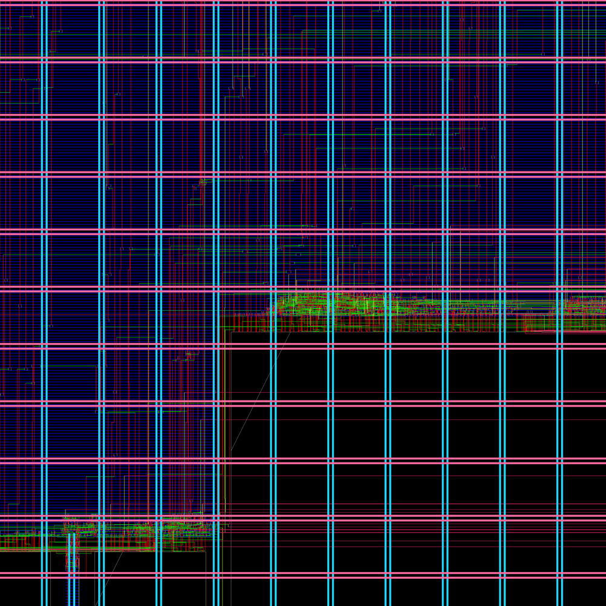
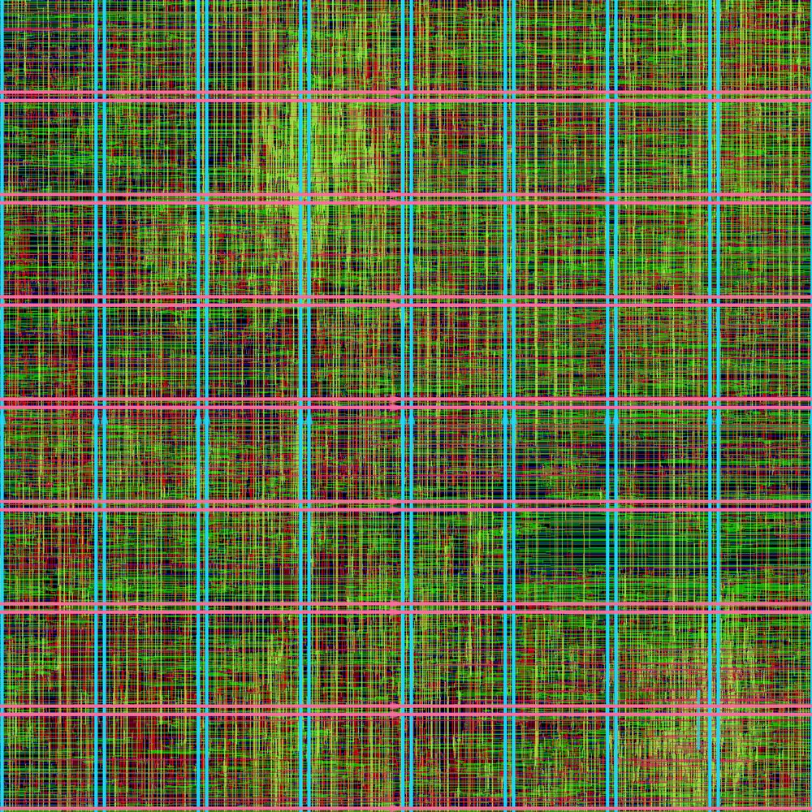

# OpenEye ASIC (IHP SG13G2) – Design-Report Run p2_16

Stand: 2026-11-05, Daten aus dem LibreLane-Run `p2_16` nach Detailverdrahtung,
Parasitenextraktion (RCX) und Sign-off-STA (Schritt 58 `OpenROAD.STAPostPNR`).
Die physikalische Verifikation (Antenne, DRC, LVS; Schritte 64–80) lief beim
Erstellen dieses Reports noch. Ihre Ergebnisse fehlen hier.

> **Kurzfassung.** Vollständig verdrahtetes Layout auf 10,5 × 10,5 mm² mit
> 48 PEs, 41 SRAM-Makros und 1,62 Mio. Standardzellen. Die Detailverdrahtung
> ist DRC-frei. Bei 25 ns (40 MHz) ist **typ erfüllt**. Im **slow-Corner**
> fehlen 1,45 ns (17 Endpunkte, fmax ≈ 37,8 MHz), im **fast-Corner** gibt es
> −0,34 ns Hold (96 Endpunkte). Die Leistung liegt bei 334 mW (typ, vektorlose
> Schätzung). Die Fläche ist von den Latch-Scratchpads der PEs dominiert,
> die Leistung vom Taktnetz.

## Inhalt

1. [Konfiguration](#1-konfiguration)
2. [Implementierung und Flow](#2-implementierung-und-flow)
3. [Chip-Kennzahlen](#3-chip-kennzahlen)
4. [Layout](#4-layout)
5. [Fläche und Leistung nach Modul](#5-fläche-und-leistung-nach-modul)
6. [Timing](#6-timing)
7. [Bewertung und offene Punkte](#7-bewertung-und-offene-punkte)
8. [Methodik und Reproduktion](#8-methodik-und-reproduktion)

## 1. Konfiguration

| Parameter | Wert |
|---|---|
| Cluster (`CLUSTER_ROWS` × `CLUSTER_COLUMNS`) | 2 × 2 |
| PEs pro Cluster (`PE_ROWS` × `PE_COLUMNS`) | 3 × 4 → **48 PEs** |
| MACs pro PE (`PARALLEL_MACS`) | 2 → 96 MACs |
| Sparsity (`SPARSITY_EN`) | an |
| GLBs (`NUM_GLB_IACT` / `_PSUM` / `_WGHT`) | 1 / 4 / 3 |
| Datenbreiten | iact/wght 24 bit pro Transfer, psum 20 bit, DMA 64 bit |
| Taktziel dieses Runs | 25 ns (40 MHz), `IO_DELAY_CONSTRAINT` 32 % |

**PE-Scratchpads** (pro PE, als Latch-Registerfile mit einem ICG pro Wort,
`asic/rtl/sg13g2/sg13g2_latch_rf.v`):

| SPad | Worte × Bit | Latches/PE | ICGs/PE |
|---|---|---:|---:|
| weight_data_SPad | 256 × 24 | 6.144 | 256 |
| psum_SPad (2×) | 2 × 32 × 20 | 1.280 | 64 |
| weight_addr_SPad | 64 × 8 | 512 | 64 |
| iact_data_SPad | 16 × 12 | 192 | 16 |
| iact_addr_SPad | 16 × 4 | 64 | 16 |
| **Summe 48 PEs** | | **393.216** | **19.968** |

**SRAM-Makros** (`RM_IHPSG13_1P_*`, 41 Instanzen):

| Puffer | Organisation | Makros |
|---|---|---|
| wght_buffer (GLB Gewichte) | 2048 × 288 | 4 × 2048x64 + 1 × 2048x32 |
| BUFFER_A[0..3] (iact layer buffer) | 4 × 1024 × 64 | 4 × 1024x64 |
| psum_buffer (2×2 Cluster × 2 GLB) | 8 × 4096 × 40 | 8 × (2 × 4096x16 + 4096x8) = 24 |
| iact_stream_constructor (4×) | 4 × 1024 × 24 | 4 × (1024x16 + 1024x8) = 8 |

## 2. Implementierung und Flow

- **Werkzeuge:** LibreLane 3.1 (Chip-Flow, 83 Schritte) im Container
  `iic-osic-tools`, PDK IHP SG13G2 (stdcell, io, sram).
- **Floorplan v2:** Die 10,5 × 10,5 mm² Die mit Padring hat 68 Eingangs-,
  67 Ausgangs- und 8 Versorgungspads, Bondpads 70 × 70 µm. Alle SRAM-Makros
  liegen in je einer Reihe am unteren (Orientierung MX) und oberen (R0)
  Core-Rand, mit den Pin-Kanten zur Core-Mitte (`asic/scripts/macro_placement.py`).
  Halos sind 20 µm.
- **Run-Verlauf:**
  - Synthese bis GRT bei 20 ns.
  - Ab dem Resizer nach GRT (Schritt 43, neu als 45) wurde mit 25 ns und
    voller Hold-Reparatur weitergerechnet
    (`asic/rtl/sg13g2/openeye_overlay_40mhz_holdfix.json`).
  - Die Abnahme-Prüfungen laufen nur als Bericht (`ERROR_ON_*` = false).
- **Funktion:** Die Gate-Level-Simulation der p2_16-Netzliste
  (cocotb `start_test_fpga`, Verilator) war **PASS**
  (`asic/runs/gatesim_p2_16.log`, 2026-11-01).

Längste Flow-Schritte (Wall-Clock):

| Schritt | Laufzeit |
|---|---:|
| 35 CTS | 10 h 59 min |
| 47 Detailverdrahtung | 13 h 05 min |
| 62 KLayout XOR | 11 h 07 min |
| 43 + 45 Resizer nach GRT (20 ns / 25 ns) | 5 h 10 min + 3 h 37 min |
| 37 Resizer nach CTS | 4 h 06 min |
| 55 Fill-Insertion | 2 h 03 min |
| 59 Magic Streamout | 1 h 36 min |
| 32 RepairDesign nach GPL | 1 h 13 min |
| 39 Globales Routing (0 Overflow) | 42 min |

## 3. Chip-Kennzahlen

| Größe | Wert |
|---|---:|
| Die / Core | 110,25 mm² / 97,16 mm² (9,86 × 9,85 mm) |
| Standardzellen (ohne Fill) | 1.618.560 Zellen, 30,44 mm² |
| Ausnutzung Core (alle Instanzen / nur Standardzellen) | 40,7 % / 34,6 % |
| SRAM-Makros | 41, 9,09 mm² |
| Padring (Pads, Spacer, Ecken) | 827 Zellen, 7,23 mm² Pads + 5,17 mm² Spacer |
| Sequentiell | 393.216 Latches (dlhq), 51.883 Flipflops, 19.968 ICGs |
| Taktbaum | 106.906 Taktpuffer + 2.638 Taktinverter, 4,60 mm² |
| Timing-Reparaturpuffer | 328.124 (3,56 mm²) |
| Antennendioden | 19.344 (17.502 durch Reparatur) |
| Verdrahtung | 108,6 m Leiterbahnlänge, 11,1 Mio. Vias, 1,60 Mio. Netze |
| Detailverdrahtung | 0 DRC-Fehler nach 10 Iterationen (10.861 in Iteration 0) |
| Antennen nach Verdrahtung | 77 Netze / 78 Pins verletzt (OpenROAD-Check) |
| Max-Slew / Max-Cap / Max-Fanout | 1.488 / 459 / 5.444 Verletzungen |

**Leistung (vektorlos, Standard-Schaltaktivität, 40 MHz)** aus `power.rpt`
von Schritt 58:

| Gruppe | typ 1,20 V 25 °C | slow 1,08 V 125 °C | fast 1,32 V −40 °C |
|---|---:|---:|---:|
| Sequentiell | 108,3 mW (32,5 %) | 86,9 mW | 132,0 mW |
| Kombinatorik | 5,0 mW (1,5 %) | 4,5 mW | 6,5 mW |
| Taktnetz | 131,9 mW (39,5 %) | 102,0 mW | 173,8 mW |
| SRAM-Makros | 88,1 mW (26,4 %) | 71,7 mW | 110,2 mW |
| Pads | 0,3 mW | 0,2 mW | 0,3 mW |
| **Summe** | **333,7 mW** | **265,1 mW** | **422,6 mW** |
| davon Leckstrom | 3,8 mW | 3,2 mW | 13,0 mW |

Die Leistungswerte beruhen nicht auf Simulationsdaten. OpenSTA setzt
Standardaktivitäten an den Eingängen an und propagiert sie. Der
Kombinatorik-Anteil ist damit sehr wahrscheinlich unterschätzt. Takt,
Register und Makros (Takt-getrieben) sind belastbarer. Für echte Werte
müsste man die Aktivität aus einer Gate-Level-Simulation übernehmen
(SAIF/VCD), siehe Abschnitt 7.

## 4. Layout

**Gesamtansicht des verdrahteten Chips** (OpenROAD, alle Layer; Makroreihen
oben und unten, Padring außen):



**Platzierung nach Modul.** Je 20 × 20 µm ist das Modul mit den meisten
Zellen eingefärbt. SRAM-Makros sind dunkelgrau, Pads hellgrau:



**Die vier Cluster:**



**Leistungsdichte der Standardzellen** (typ, vektorlos, 100-µm-Raster):



**Ausschnitte:** Links die Pin-Kante einer Makroreihe unten (Pins zeigen nach
innen, die Verdrahtung läuft in den Core). Rechts 600 × 600 µm in der
Chipmitte.

<p>


</p>

## 5. Fläche und Leistung nach Modul

| Modul | Inst. | Zellen | Fläche [mm²] | Anteil | davon Latch / FF / Komb. / Puffer [mm²] | Leistung typ [mW] | Anteil |
|---|---:|---:|---:|---:|---|---:|---:|
| PE / weight_data_SPad | 48 | 818,949 | 14.274 | 30.1 % | 9.097 / 0.075 / 3.675 / 1.035 | 11.3 | 3.7 % |
| PE / psum_SPad | 48 | 193,122 | 3.404 | 7.2 % | 1.895 / 0.210 / 0.805 / 0.382 | 11.4 | 3.7 % |
| PE / weight_addr_SPad | 48 | 84,980 | 1.450 | 3.1 % | 0.758 / 0.038 / 0.354 / 0.212 | 3.6 | 1.2 % |
| PE / iact_addr_SPad | 48 | 15,908 | 0.297 | 0.6 % | 0.095 / 0.019 / 0.068 / 0.092 | 1.3 | 0.4 % |
| PE / iact_data_SPad | 48 | 32,647 | 0.681 | 1.4 % | 0.284 / 0.087 / 0.152 / 0.128 | 4.4 | 1.4 % |
| PE / multiplier | 48 | 41,004 | 0.531 | 1.1 % | 0.000 / 0.135 / 0.321 / 0.067 | 6.0 | 2.0 % |
| PE / iact_data_handler | 48 | 20,005 | 0.305 | 0.6 % | 0.000 / 0.108 / 0.101 / 0.092 | 4.8 | 1.6 % |
| PE / wght_data_handler | 48 | 39,333 | 0.548 | 1.2 % | 0.000 / 0.179 / 0.244 / 0.114 | 8.0 | 2.6 % |
| PE / mux_psum | 48 | 4,353 | 0.087 | 0.2 % | 0.000 / 0.047 / 0.024 / 0.015 | 2.1 | 0.7 % |
| PE / gen_sparse_fsm | 48 | 27,063 | 0.420 | 0.9 % | 0.000 / 0.161 / 0.143 / 0.115 | 7.1 | 2.3 % |
| PE / PE-Logik | 48 | 118,214 | 1.878 | 4.0 % | 0.000 / 0.713 / 0.586 / 0.571 | 31.7 | 10.5 % |
| Cluster / router_iact | 4 | 470 | 0.006 | 0.0 % | 0.000 / 0.001 / 0.003 / 0.001 | 0.3 | 0.1 % |
| Cluster / router_wght | 4 | 158 | 0.002 | 0.0 % | 0.000 / 0.001 / 0.001 / 0.001 | 0.0 | 0.0 % |
| Cluster / router_psum | 4 | 95 | 0.001 | 0.0 % | 0.000 / 0.000 / 0.000 / 0.000 | 0.0 | 0.0 % |
| Cluster / delay_cluster | 4 | 18,866 | 0.524 | 1.1 % | 0.000 / 0.357 / 0.008 / 0.158 | 15.9 | 5.3 % |
| Cluster / pe_cluster-Logik | 4 | 1,318 | 0.017 | 0.0 % | 0.000 / 0.004 / 0.005 / 0.007 | 0.2 | 0.1 % |
| Cluster / Cluster-Logik | 4 | 5,139 | 0.083 | 0.2 % | 0.000 / 0.032 / 0.018 / 0.028 | 2.2 | 0.7 % |
| BUFFER_A (iact layer buffer) | 1 | 8,028 | 1.178 | 2.5 % | 0.000 / 0.027 / 0.018 / 0.068 (+ SRAM 1.056) | 19.9 | 6.6 % |
| IO-Ring (Pads, Spacer, Bondpads) | 1 | 970 | 7.929 | 16.7 % | 0.000 / 0.000 / 0.000 / 0.000 | 0.3 | 0.1 % |
| OpenEye_Parallel-Logik | 1 | 7,193 | 0.122 | 0.3 % | 0.000 / 0.045 / 0.021 / 0.049 | 2.1 | 0.7 % |
| Taktbaum | 1 | 109,538 | 4.598 | 9.7 % | 0.000 / 0.000 / 0.024 / 4.574 | 115.6 | 38.1 % |
| Top-Logik (OpenEye_Asic) | 1 | 11,849 | 0.177 | 0.4 % | 0.000 / 0.057 / 0.059 / 0.058 | 4.7 | 1.5 % |
| dma_storage | 1 | 3,616 | 0.060 | 0.1 % | 0.000 / 0.022 / 0.024 / 0.013 | 1.8 | 0.6 % |
| iact_stream_constructor | 1 | 17,119 | 0.776 | 1.6 % | 0.000 / 0.080 / 0.086 / 0.088 (+ SRAM 0.516) | 4.1 | 1.3 % |
| nicht zugeordnet | 1 | 49 | 0.001 | 0.0 % | 0.000 / 0.000 / 0.000 / 0.000 | 0.1 | 0.0 % |
| psum_buffer (GLB psum) | 1 | 13,714 | 5.476 | 11.5 % | 0.000 / 0.016 / 0.024 / 0.122 (+ SRAM 5.293) | 9.0 | 3.0 % |
| psum_pipeline (quant+pool) | 1 | 12,483 | 0.187 | 0.4 % | 0.000 / 0.057 / 0.085 / 0.043 | 2.6 | 0.9 % |
| ring_buffer_pipelined | 1 | 6,365 | 0.117 | 0.2 % | 0.000 / 0.051 / 0.032 / 0.027 | 2.2 | 0.7 % |
| router_configurator | 1 | 222 | 0.004 | 0.0 % | 0.000 / 0.002 / 0.001 / 0.001 | 0.1 | 0.0 % |
| wght_buffer (GLB Gewichte) | 1 | 6,801 | 2.333 | 4.9 % | 0.000 / 0.015 / 0.006 / 0.076 (+ SRAM 2.228) | 30.0 | 9.9 % |
| **Summe (ohne Fill/Decap)** | | 1,619,571 | 47.466 | 100 % | | 303.0 | 100 % |

Die Leistung pro Modul stammt aus einer eigenen OpenSTA-Auswertung pro Instanz (typ, vektorlos). Ihre Summe beträgt 303 mW; die Flow-STA (Abschnitt 3) meldet 334 mW. Die Differenz liegt fast vollständig bei den SRAM-Makros (56 statt 88 mW). Wahrscheinliche Ursache: Die Flow-STA liest jede SRAM-Liberty zweimal ein; das ist nicht weiter untersucht. Die Anteile untereinander sind davon unberührt. Zahlenformat in den generierten Tabellen: Punkt als Dezimaltrenner, Komma als Tausendertrenner.

Hinweise:
- Die Summe (47,5 mm²) enthält Standardzellen, SRAM-Makros und den IO-Ring, aber keine Fill- und Decap-Zellen.
- „Inst.“ ist die Zahl der Instanzen des Moduls. Die Werte sind über alle
  Instanzen summiert, also über 48 PEs bzw. 4 Cluster.
- „Taktbaum“ sind alle CTS-Puffer und -Inverter einschließlich der gegateten
  Takte innerhalb der Latch-Registerfiles. „IO-Ring“ sind Pads, Spacer, Ecken
  und Bondpads.
- Die Logik der Latch-Registerfiles (Lese-Multiplexer, Wortdekoder) zählt zum
  jeweiligen SPad. Beim weight_data_SPad sind das 3,7 mm² Kombinatorik neben
  9,1 mm² Latches.

**Was auffällt:**
- **weight_data_SPad** ist mit 14,3 mm² (30 %) der größte Einzelposten. Neben
  9,1 mm² Latches stecken 3,7 mm² im 256:1-Lese-Multiplexer und im
  Wortdekoder. Ein 256 × 24 SRAM-Makro pro PE (256x16 + 256x8) wäre der
  größte Hebel für Fläche und Zellzahl.
- **Der Taktbaum** braucht 38 % der Leistung (116 mW) und 4,6 mm². Bei
  19.968 gegateten Wort-Takten und einer langen Kette zum Latenzausgleich
  ist das die zweite Baustelle neben dem Timing.
- **delay_cluster** besteht aus 0,36 mm² reinen Schieberegistern und braucht
  15,9 mW (5 %). Ob die Verzögerungsleitung in SRAM oder als Latch-FIFO
  günstiger wäre, ist eine Architekturfrage.
- Die 48 PEs sind praktisch gleich groß (0,49–0,51 mm²) und brauchen
  1,9–2,0 mW. Die Cluster unterscheiden sich um weniger als 0,5 %.

**Cluster und PEs** (Summe aus Logik, SPads und Routern; ohne GLB-Makros, die auf Top-Ebene liegen):

| Cluster | Fläche [mm²] | Leistung typ [mW] |
|---|---:|---:|
| C00 | 6.138 | 27.6 |
| C01 | 6.128 | 27.5 |
| C10 | 6.109 | 27.7 |
| C11 | 6.133 | 27.7 |

PE (48 Stück): Fläche min/mittel/max = 0.4931 / 0.4974 / 0.5085 mm², Leistung typ min/mittel/max = 1.87 / 1.91 / 2.02 mW.

## 6. Timing

Sign-off-STA nach RCX (Schritt 58), Takt 25 ns, Taktunsicherheit 0,25 ns,
propagierter Takt, IO-Delays 8 ns (32 %):

| Corner | Setup WNS / TNS | Setup-Verletzer | Hold WNS / TNS | Hold-Verletzer | fmax (`report_clock_min_period`) |
|---|---:|---:|---:|---:|---:|
| typ 1,20 V 25 °C | 0 / 0 | 0 | −0,025 / −0,06 ns | 3 | 61,1 MHz |
| slow 1,08 V 125 °C | **−1,451 / −12,52 ns** | 17 | +0,175 | 0 | **37,8 MHz** |
| fast 1,32 V −40 °C | 0 / 0 | 0 | **−0,341 / −18,32 ns** | 96 | 92,1 MHz |

**Taktnetz** (typ): Die Laufzeit vom Pad bis zu den Senken beträgt 4,8 bis
7,1 ns, der Skew 2,3 ns. Der Taktpad sitzt nahe einer Die-Ecke (West, Position
34/36). CTS hat eine lange Kette von Verzögerungspuffern vor dem Registerbaum
eingefügt, um ihn an die Bäume der Makros und Clock-Gates anzugleichen.

**Timing nach Modul.** Angegeben ist der schlechteste Slack in ns, in Klammern die Zahl der verletzenden Endpunkte, für alle Endpunkte (507.378 je Corner). Ein Endpunkt gehört zu dem Modul der Zelle, die ihn empfängt.

| Modul | Setup typ | Setup slow | Setup fast | Hold typ | Hold slow | Hold fast |
|---|---:|---:|---:|---:|---:|---:|
| PE / weight_data_SPad | +0.00 | +0.00 | +0.00 | +0.26 | +0.18 | +0.08 |
| PE / psum_SPad | +0.00 | **-1.45** (17) | +0.00 | +0.27 | +0.41 | +0.10 |
| PE / weight_addr_SPad | +0.00 | +0.00 | +0.00 | +0.24 | +0.53 | +0.08 |
| PE / iact_addr_SPad | +0.00 | +0.00 | +0.00 | +0.27 | +0.58 | +0.09 |
| PE / iact_data_SPad | +0.00 | +0.00 | +0.00 | +0.23 | +0.53 | +0.06 |
| PE / multiplier | +10.00 | +1.02 | +14.91 | +0.25 | +0.29 | +0.07 |
| PE / iact_data_handler | +12.27 | +4.68 | +14.91 | +0.28 | +0.59 | +0.10 |
| PE / wght_data_handler | +12.23 | +5.80 | +15.45 | +0.25 | +0.55 | +0.08 |
| PE / mux_psum | +14.56 | +9.53 | +15.44 | +0.18 | +0.45 | +0.02 |
| PE / gen_sparse_fsm | +14.79 | +11.08 | +15.52 | +0.26 | +0.55 | +0.07 |
| PE / PE-Logik | +11.43 | +3.56 | +15.15 | +0.19 | +0.50 | +0.02 |
| Cluster / router_iact | +16.50 | +11.50 | +19.31 | +0.36 | +0.72 | +0.15 |
| Cluster / router_wght | +15.07 | +8.93 | +18.49 | +0.37 | +0.74 | +0.17 |
| Cluster / router_psum | +20.09 | +17.66 | +21.56 | +0.29 | +0.62 | +0.11 |
| Cluster / delay_cluster | +14.00 | +9.26 | +15.06 | +0.16 | +0.41 | +0.03 |
| Cluster / pe_cluster-Logik | +13.48 | +7.12 | +17.13 | +0.19 | +0.47 | +0.04 |
| Cluster / Cluster-Logik | +13.46 | +6.67 | +17.48 | +0.23 | +0.47 | +0.09 |
| BUFFER_A (iact layer buffer) | +12.17 | +5.16 | +16.19 | +0.24 | +0.53 | **-0.17** (23) |
| OpenEye_Parallel-Logik | +12.69 | +5.76 | +16.61 | +0.25 | +0.56 | +0.08 |
| Top-Logik (OpenEye_Asic) | +13.91 | +7.68 | +15.88 | +0.27 | +0.59 | +0.10 |
| dma_storage | +16.52 | +13.65 | +16.73 | +0.34 | +0.70 | +0.14 |
| iact_stream_constructor | +12.48 | +6.32 | +15.18 | +0.16 | +0.52 | **-0.11** (5) |
| psum_buffer (GLB psum) | +14.58 | +8.60 | +15.47 | +0.15 | +0.39 | +0.01 |
| psum_pipeline (quant+pool) | +12.50 | +8.05 | +14.07 | +0.28 | +0.60 | +0.11 |
| ring_buffer_pipelined | +18.24 | +14.68 | +20.44 | +0.31 | +0.65 | +0.12 |
| router_configurator | +17.56 | +13.67 | +19.98 | +0.30 | +0.63 | +0.11 |
| wght_buffer (GLB Gewichte) | +15.99 | +10.50 | +19.03 | **-0.03** (3) | +0.59 | **-0.34** (68) |
| IO-Ports | +6.88 | +2.25 | +9.43 | +14.68 | +18.77 | +12.58 |

„+0.00“ bei den SPads ist kein knapper Pfad: An Latch-D-Eingängen leiht sich OpenSTA Zeit aus der transparenten Phase (Time Borrowing) und meldet 0 Slack. Der geliehene Anteil wird auf dem Folgepfad (Lese-Mux → Ausgangsregister) geprüft und ist dort erfüllt.

**Schlechteste Endpunkte je Corner:**

| Corner | Prüfung | Slack [ns] | schlechtester Endpunkt |
|---|---|---:|---|
| fast | Setup (clk_pad) | +0.000 | `u_openeye.OpenEye_Parallel.gen_x[0].gen_y[1].OpenEye_Cluster.pe_cluster.gen_X[2].gen_Y[0].pe.weight_data_SPad.ram.g_word[229].g_bit[1].u_lat.u_lat/D` |
| fast | Hold (clk_pad) | -0.341 | `u_openeye.wght_buffer.g_specific.impl.g_cfg2048x288.u_mac0/A_DIN[56]` |
| slow | Setup (clk_pad) | -1.451 | `u_openeye.OpenEye_Parallel.gen_x[0].gen_y[0].OpenEye_Cluster.pe_cluster.gen_X[1].gen_Y[0].pe.gen_serial_psum_spad.gen_psum_spad[1].psum_SPad.ram.g_word[29].u_icg.u_icg/GATE` |
| slow | Hold (clk_pad) | +0.175 | `_1375155_/D` |
| typ | Setup (clk_pad) | +0.000 | `u_openeye.OpenEye_Parallel.gen_x[0].gen_y[1].OpenEye_Cluster.pe_cluster.gen_X[2].gen_Y[0].pe.weight_data_SPad.ram.g_word[228].g_bit[1].u_lat.u_lat/D` |
| typ | Hold (clk_pad) | -0.025 | `u_openeye.wght_buffer.g_specific.impl.g_cfg2048x288.u_mac0/A_DIN[56]` |

**Einordnung der Verletzer:**
- **Setup slow (17 Endpunkte):** Alle liegen am `GATE`-Eingang der Clock-Gates
  in den psum_SPads. Der Freigabepfad vom Adressregister über den Wortdekoder
  braucht im slow-Corner rund 25 ns. Lösung: den Wortdekoder registrieren oder
  den Pfad im RTL verkürzen, oder für slow die Taktperiode auf ≥ 26,5 ns setzen.
- **Hold fast (96) und typ (3):** Alle liegen auf Pfaden vom Register zu den
  SRAM-Makros (`A_DIN`/`A_ADDR` von wght_buffer, BUFFER_A, iact_sc). Der
  Makrotakt `A_CLK` kommt später an als der Takt der sendenden Flipflops. Die
  Hold-Reparatur nach GRT hat dafür nur 7 Puffer eingesetzt (RSZ-0064), weil
  die Abschätzung vor der Verdrahtung pessimistischer war als die
  Extraktionswerte. Lösung: eine Hold-ECO nach der Verdrahtung (wenige
  Dutzend Verzögerungszellen) oder ein Taktbaum, der Makros und Register
  angleicht (p2_17).
- **IO:** Bei 25 ns erfüllt. Bei 20 ns verletzten die Ausgangspads um
  −2,2 ns (Taktlaufzeit plus Pad-Laufzeit).

## 7. Bewertung und offene Punkte

**Was funktioniert:**
- Floorplan v2 lässt sich verdrahten (GRT 0 Overflow, DRT 0 DRC).
- Die Latch-Scratchpads ersetzen etwa 393k Enable-Flipflops und sparen
  gegenüber p2_15 rund die Hälfte der Registerfläche.
- Die Gate-Level-Simulation ist bestanden.
- Der Core selbst würde deutlich schneller laufen (typ fmax 61 MHz, fast
  92 MHz).

**Was fehlt bis zum Tapeout:**
1. Timing-Sign-off in allen Corners: Hold-ECO nach der Verdrahtung, und für
   Setup entweder das psum-ICG-Enable im RTL verkürzen oder auf ≤ 37 MHz
   spezifizieren.
2. Taktbaum (p2_17): Taktpad in die Mitte einer Seite, weniger
   Latenz-Ausgleich per Verzögerungskette, Makrotakte zu den Registern hin
   angleichen.
3. Max-Slew/Cap/Fanout (1.488/459/5.444) und 77 Antennennetze klären.
4. Physikalische Verifikation (DRC, LVS) abwarten und einordnen. Die
   bekannten PDK-Lücken sind: Bondpad↔Pad-Port im LVS, Pad-vdd-Pins nicht
   angeschlossen (PSM-0069), Sealring-Versatz, SRAM `vddarray`/`vssarray`.
   Der PDN-Metrik-Zähler von 943.738 `power_grid_violation` hängt
   wahrscheinlich an der Pad-Versorgungslücke (Rails gelten als
   unverbunden). Das ist noch zu verifizieren.
5. Leistung mit echter Schaltaktivität (SAIF aus der Gate-Simulation von
   `start_test_fpga`) neu bewerten.

## 8. Methodik und Reproduktion

- **Zuordnung zu Modulen:** Die Netzliste ist flach (Synthese mit flatten).
  Zellen mit hierarchischem Namen (Latches, ICGs, Makros) werden exakt
  zugeordnet. Die anonymen Zellen (`_123_`, Resizer-Puffer) werden über
  hierarchische Netznamen an Aus- oder Eingängen zugeordnet, danach per
  Mehrheitsentscheid über die Netz-Nachbarschaft. Netze mit mehr als 40 Pins
  sind dabei ausgeschlossen. Die Aufteilung der Kombinatorik an
  Modulgrenzen ist deshalb eine Schätzung. Ergebnis für p2_16: 416.798 Zellen über den Instanznamen, 72.220 über den Ausgangsnetznamen, 369.324 über Eingangsnetznamen, 109.538 als Taktbaum und 970 als IO-Ring. Die übrigen rund 650.000 Zellen wurden per Nachbarschaft einem Modul zugeordnet, 49 Zellen blieben ohne Modul.
- **Skripte:**
  - `asic/scripts/doc/module_sta.tcl`: OpenSTA, Slack pro Endpunkt für alle
    drei Corner und Leistung pro Instanz (typ). Geladen werden Netzliste und
    SDC aus Schritt 55 und die SPEF aus Schritt 57, mit denselben Libraries
    wie die Sign-off-STA.
  - `asic/scripts/doc/module_report.py`: Zuordnung, Tabellen, Plots.
  - `asic/scripts/doc/layout_snapshot.tcl`: OpenROAD-GUI offscreen,
    Layout-Bilder aus der ODB von Schritt 56.
- **Rohdaten:** `asic/doc/data/p2_16_modules_by_instance.csv` (pro
  Modulinstanz: Zellen, Fläche, Leistung, Slack pro Corner) und
  `p2_16_summary.json`.
- **Aufruf** im Container:
  ```
  for c in typ slow fast; do
    CORNER=$c DO_POWER=$([ $c = typ ] && echo 1 || echo 0) \
    RUN_DIR=asic/runs/openeye_p2_16/design/runs/p2_16 OUT_DIR=asic/runs/doc_p2_16 \
    sta -no_splash -exit asic/scripts/doc/module_sta.tcl &
  done; wait
  python3 asic/scripts/doc/module_report.py asic/runs/openeye_p2_16/design/runs/p2_16 \
      asic/runs/doc_p2_16 asic/runs/doc_p2_16/report
  QT_QPA_PLATFORM=offscreen ODB=.../56-odb-cellfrequencytables/OpenEye_Asic.odb \
      OUT_DIR=asic/runs/doc_p2_16/snap openroad -gui -no_splash -exit \
      asic/scripts/doc/layout_snapshot.tcl
  ```
